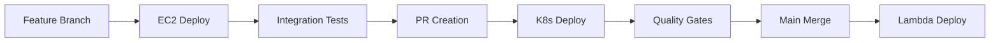

# 🚀 Solar System App - DevOps Project

[](https://jenkins.example.com)
[](https://sonarqube.example.com)
[](https://hub.docker.com/r/mohamed710/solar-system-gitea)
[](https://opensource.org/licenses/MIT)
[](https://jenkins.example.com)
[](https://sonarqube.example.com)

> **Enterprise-grade DevOps pipeline showcasing CI/CD, security scanning, multi-environment deployment, and GitOps practices**

## 📸 Screenshots

### Application UI


### Jenkins Pipeline Dashboard


### Slack Notifications


### SonarQube Quality Dashboard


### Trivy Security Scan Results


---

## 🌟 Overview

The **Solar System App** is a comprehensive DevOps demonstration project that showcases enterprise-level CI/CD practices, security automation, and multi-environment deployment strategies. Built with Node.js and Express, this project serves as a reference implementation for modern DevOps workflows including:

- **Automated CI/CD Pipeline** with Jenkins
- **Multi-stage Security Scanning** (SAST, DAST, Dependency checks)
- **Container Security** with Trivy vulnerability scanning
- **Code Quality Gates** via SonarQube
- **Multi-environment Deployment** (AWS EC2, Kubernetes, Lambda)
- **GitOps Workflow** with automated PR creation
- **Real-time Notifications** via Slack integration

---

## ✨ Features

### 🔄 CI/CD Pipeline
- **Automated Testing** with Mocha/Chai and 90%+ coverage
- **Security Scanning** at every pipeline stage
- **Quality Gates** with SonarQube integration
- **Multi-environment Deployment** based on branch strategy
- **Rollback Capabilities** with container versioning

### 🔒 Security & Compliance
- **SAST Scanning** with SonarQube
- **DAST Testing** with OWASP ZAP
- **Dependency Vulnerability** scanning with OWASP Dependency Check
- **Container Security** with Trivy
- **Secret Management** via Jenkins credentials
- **npm Audit** integration for package security

### 🚀 Deployment & Infrastructure
- **Docker Containerization** with multi-stage builds
- **AWS EC2** deployment for feature branches
- **Kubernetes** deployment with GitOps workflow
- **AWS Lambda** serverless deployment for production
- **S3 Integration** for artifact storage and reporting

### 📊 Monitoring & Observability
- **Health Check Endpoints** (`/live`, `/ready`, `/os`)
- **Pipeline Metrics** and build analytics
- **Security Report** archiving and S3 storage
- **Slack Notifications** for build status
- **Comprehensive Logging** across all environments

---

## 🏗️ Architecture

```
┌─────────────────────────────────────────────────────────────────────────────┐
│                           DevOps Architecture                              │
└─────────────────────────────────────────────────────────────────────────────┘

┌─────────────────┐    ┌─────────────────┐    ┌─────────────────┐
│   Frontend      │    │   Backend       │    │   Database      │
│   (HTML/CSS/JS) │◄──►│   (Node.js/     │◄──►│   (MongoDB)     │
│                 │    │    Express)     │    │                 │
└─────────────────┘    └─────────────────┘    └─────────────────┘
         │                       │                       │
         │                       │                       │
         ▼                       ▼                       ▼
┌─────────────────────────────────────────────────────────────────────────────┐
│                        CI/CD Pipeline (Jenkins)                           │
│                                                                             │
│  Code → Test → Security → Build → Container → Deploy → Monitor → Notify   │
│    │      │      │        │         │         │         │         │       │
│    ▼      ▼      ▼        ▼         ▼         ▼         ▼         ▼       │
│  Git    Mocha  OWASP   Docker   Trivy    AWS/K8s   Health   Slack      │
│         Chai   ZAP     Build    Scan     Deploy    Check    Alert      │
└─────────────────────────────────────────────────────────────────────────────┘
         │                       │                       │
         │                       │                       │
         ▼                       ▼                       ▼
┌─────────────────┐    ┌─────────────────┐    ┌─────────────────┐
│   AWS EC2       │    │   Kubernetes    │    │   AWS Lambda    │
│   (Feature)     │    │   (PR Branch)   │    │   (Production)  │
└─────────────────┘    └─────────────────┘    └─────────────────┘
```

---

## 🛠️ Tech Stack

### **Application Layer**
- **Runtime**: Node.js 22.6.0
- **Framework**: Express.js 4.18.2
- **Database**: MongoDB 6.13.6 with Mongoose ODM
- **Testing**: Mocha + Chai + Chai-HTTP
- **Coverage**: NYC (Istanbul) with 90% threshold

### **DevOps & Infrastructure**
- **CI/CD**: Jenkins with declarative pipelines
- **Containerization**: Docker with multi-stage builds
- **Security Scanning**: 
  - OWASP ZAP (DAST)
  - Trivy (Container security)
  - OWASP Dependency Check
  - SonarQube (SAST)
- **Cloud Platforms**: AWS (EC2, Lambda, S3, IAM)
- **Orchestration**: Kubernetes with GitOps
- **Monitoring**: Slack, Jenkins metrics, health checks

### **Frontend & UI**
- **HTML5**: Semantic markup
- **CSS3**: Responsive design with animations
- **JavaScript**: Vanilla JS for interactivity
- **Fonts**: Google Fonts (Ubuntu, Encode Sans, BioRhyme, Orbitron)

---

## 🔄 Pipeline Workflow

### **Stage 1: Code Quality & Security**
```bash
1. Dependencies Installation
   ├── npm install --no-audit
   └── npm audit --audit-level=critical

2. Security Scanning
   ├── OWASP Dependency Check
   ├── npm audit validation
   └── Vulnerability assessment
```

### **Stage 2: Testing & Coverage**
```bash
3. Unit Testing
   ├── Mocha test execution
   ├── Retry mechanism (2 attempts)
   └── JUnit report generation

4. Code Coverage
   ├── NYC coverage analysis
   ├── 90% line coverage requirement
   └── HTML/XML report generation
```

### **Stage 3: Quality Gates**
```bash
5. SonarQube Analysis
   ├── Code quality assessment
   ├── Security hotspot detection
   └── Quality gate validation

6. Container Security
   ├── Docker image build
   ├── Trivy vulnerability scan
   └── Security report generation
```

### **Stage 4: Deployment Strategy**
```bash
7. Environment-Specific Deployment
   ├── Feature Branch → AWS EC2
   ├── PR Branch → Kubernetes
   └── Main Branch → AWS Lambda

8. Integration Testing
   ├── End-to-end validation
   ├── Health check verification
   └── Performance testing
```

---

## 🌿 Branching Strategy

### **Branch Types & Deployment**

| Branch Pattern | Environment | Deployment Target | Purpose |
|----------------|-------------|-------------------|---------|
| `feature/*` | Development | AWS EC2 | Feature testing & validation |
| `PR*` | Staging | Kubernetes | Pre-production validation |
| `main` | Production | AWS Lambda | Production deployment |

### **Workflow Process**



### **Deployment Triggers**
- **Feature branches**: Automatic deployment to EC2 for testing
- **PR branches**: Kubernetes deployment with GitOps workflow
- **Main branch**: Production deployment to AWS Lambda with manual approval

---

## 🚀 Deployment Instructions

### **AWS EC2 Deployment (Feature Branches)**

```bash
# SSH into EC2 instance
ssh -o StrictHostKeyChecking=no ec2-user@YOUR_EC2_IP

# Stop existing container
sudo docker stop solar-system-gitea
sudo docker rm solar-system-gitea

# Pull new image
sudo docker pull mohamed710/solar-system-gitea:$GIT_COMMIT

# Run new container
sudo docker run -d \
  --name solar-system-gitea \
  -e MONGO_URI='$MONGO_URI' \
  -p 3000:3000 \
  mohamed710/solar-system-gitea:$GIT_COMMIT
```

### **Kubernetes Deployment (PR Branches)**

```bash
# Clone GitOps repository
git clone -b main https://github.com/mhmdmstfa2010/solar-system-gitops.git

# Update image tag in deployment
sed -i "s#mohamed710/solar-system-gitea.*#mohamed710/solar-system-gitea:$GIT_COMMIT#g" deployment.yml

# Apply configuration
kubectl apply -f deployment.yml
kubectl apply -f service.yml

# Verify deployment
kubectl get pods -l app=solar-system-gitea
kubectl get services -l app=solar-system-gitea
```

### **AWS Lambda Deployment (Production)**

```bash
# Prepare Lambda package
zip -qr solar-system-lambda-$BUILD_ID.zip app* package* index.html node*

# Upload to S3
aws s3 cp solar-system-lambda-$BUILD_ID.zip s3://solar-sys-lambda-bucket/

# Update Lambda function
aws lambda update-function-code \
  --function-name solar-system \
  --s3-bucket solar-sys-lambda-bucket \
  --s3-key solar-system-lambda-$BUILD_ID.zip

# Verify deployment
aws lambda get-function --function-name solar-system
```

---

## 🔌 API Endpoints

### **Core API Endpoints**

#### **Planet Information**
```bash
POST /planet
Content-Type: application/json

Request:
{
  "id": 3
}

Response:
{
  "id": 3,
  "name": "Earth",
  "description": "Our home planet",
  "image": "",
  "velocity": "29.78 km/s",
  "distance": "149.6 million km"
}
```

#### **Health Check Endpoints**
```bash
GET /live    # Liveness probe - returns { "status": "live" }
GET /ready   # Readiness probe - returns { "status": "ready" }
GET /os      # System info - returns { "os": "hostname", "env": "NODE_ENV" }
GET /        # Main application interface
GET /api-docs # OpenAPI specification
```

### **API Testing Examples**

```bash
# Test health endpoint
curl -X GET http://localhost:3000/live

# Test planet endpoint
curl -X POST http://localhost:3000/planet \
  -H "Content-Type: application/json" \
  -d '{"id": 3}'

# Test system info
curl -X GET http://localhost:3000/os
```

---

## 🔒 Security Section

### **SAST (Static Application Security Testing)**

#### **SonarQube Analysis**
- **Code Quality Gates**: Maintainability, Reliability, Security
- **Security Hotspots**: Vulnerability detection in source code
- **Code Smells**: Code quality and best practices enforcement
- **Coverage Requirements**: 90% line coverage threshold

```bash
# SonarQube Scanner Execution
${SONAR_SCANNER_HOME}/bin/sonar-scanner

# Quality Gate Validation
# - Maintainability: A
# - Reliability: A  
# - Security: A
# - Coverage: 90%+
```

### **DAST (Dynamic Application Security Testing)**

#### **OWASP ZAP Integration**
- **API Security Testing**: OpenAPI specification validation
- **Vulnerability Scanning**: Active and passive security testing
- **Report Generation**: HTML, JSON, XML, and Markdown formats
- **Automated Scanning**: Integrated into CI/CD pipeline

```bash
# ZAP API Scan Execution
docker run -v $(pwd):/zap/wrk/:rw ghcr.io/zaproxy/zaproxy zap-api-scan.py \
  -t http://192.168.49.2:32134/api-docs \
  -f openapi \
  -r zap-report.html \
  -J zap-report.json \
  -x zap-report.xml \
  -w zap-report.md
```

### **Dependency Security Scanning**

#### **OWASP Dependency Check**
- **Vulnerability Detection**: Known CVE identification
- **License Compliance**: Open source license validation
- **Outdated Dependencies**: Security patch recommendations
- **Comprehensive Reporting**: Multiple output formats

```bash
# Dependency Check Execution
dependencyCheck additionalArguments: '''
  --scan ./
  --out ./
  --format ALL
  --disableYarnAudit
  --prettyPrint
  --noupdate
''', odcInstallation: 'OWASP-DependencyCheck-10'
```

#### **npm Audit Integration**
- **Package Vulnerability**: npm package security validation
- **Critical Issues**: High-severity vulnerability detection
- **Automatic Blocking**: Pipeline failure on critical issues
- **Remediation Guidance**: Fix recommendations

```bash
# npm Audit Execution
npm audit --audit-level=critical || true
```

### **Container Security**

#### **Trivy Vulnerability Scanning**
- **Image Scanning**: Container image vulnerability assessment
- **Severity Levels**: LOW, MEDIUM, HIGH, CRITICAL classification
- **Multiple Formats**: JSON, HTML, JUnit report generation
- **Pipeline Integration**: Automated scanning in CI/CD

```bash
# Trivy Scan Execution
trivy image mohamed710/solar-system-gitea:$GIT_COMMIT \
  --severity LOW,MEDIUM,HIGH \
  --exit-code 0 \
  --quiet \
  --format json -o trivy-low-medium-report.json

trivy image mohamed710/solar-system-gitea:$GIT_COMMIT \
  --severity CRITICAL \
  --exit-code 1 \
  --quiet \
  --format json -o trivy-critical-high-report.json
```

### **Secrets Management**

#### **Jenkins Credentials**
- **MongoDB URI**: Database connection string encryption
- **DockerHub Credentials**: Container registry authentication
- **GitHub Token**: Repository access and PR creation
- **AWS Credentials**: Cloud service authentication

```bash
# Credential Usage in Pipeline
environment {
  MONGO_URI = credentials('mongo-credentials-uri')
  DOCKERHUB_CREDENTIALS = credentials('DockerHub_cred')
  GITHUB_TOKEN = credentials('github-token')
}
```

---

## 📱 Slack Notifications

### **Notification Configuration**

#### **Pipeline Status Notifications**
- **Success Notifications**: ✅ Build completion alerts
- **Failure Notifications**: ❌ Build failure alerts with details
- **Channel Integration**: #general channel for team visibility
- **Rich Information**: Build URL, job name, and build number

```groovy
// Slack Notification Configuration
post {
    success {
        slackSend channel: '#general', 
                  message: "✅ Pipeline succeeded for Job '${env.JOB_NAME} [${env.BUILD_NUMBER}]' \nURL: ${env.BUILD_URL}"
    }
    failure {
        slackSend channel: '#general', 
                  message: "❌ Pipeline failed for Job '${env.JOB_NAME} [${env.BUILD_NUMBER}]' \nURL: ${env.BUILD_URL}"
    }
}
```

### **Notification Features**
- **Real-time Updates**: Immediate pipeline status notifications
- **Rich Formatting**: Emojis and structured messages
- **Actionable Links**: Direct access to build details
- **Team Collaboration**: Centralized communication channel

### **Customization Options**
- **Channel Selection**: Configurable notification channels
- **Message Templates**: Customizable notification formats
- **Conditional Notifications**: Stage-specific alerts
- **Integration Hooks**: Webhook support for external tools

---

## 🤝 Contributing Guide

### **Development Workflow**

#### **1. Fork & Clone**
```bash
# Fork the repository on GitHub
# Clone your fork locally
git clone https://github.com/YOUR_USERNAME/solar-system-gitea.git
cd solar-system-gitea

# Add upstream remote
git remote add upstream https://github.com/mhmdmstfa2010/solar-system-gitea.git
```

#### **2. Create Feature Branch**
```bash
# Create and checkout feature branch
git checkout -b feature/amazing-feature

# Ensure branch naming follows convention
# feature/* for new features
# bugfix/* for bug fixes
# hotfix/* for urgent fixes
```

#### **3. Development & Testing**
```bash
# Install dependencies
npm install

# Run tests locally
npm test

# Check coverage
npm run coverage

# Ensure 90%+ coverage threshold
```

#### **4. Commit & Push**
```bash
# Stage changes
git add .

# Commit with conventional message
git commit -m "feat: add amazing feature"

# Push to your fork
git push origin feature/amazing-feature
```

#### **5. Pull Request**
- Create PR against `main` branch
- Ensure all CI/CD checks pass
- Request code review from maintainers
- Address feedback and suggestions

### **Code Standards**

#### **JavaScript/Node.js**
- **ES6+ Syntax**: Use modern JavaScript features
- **Error Handling**: Comprehensive error handling and logging
- **Async/Await**: Prefer async/await over callbacks
- **Testing**: Maintain 90%+ test coverage

#### **DevOps & Pipeline**
- **Pipeline Syntax**: Use declarative Jenkins syntax
- **Security First**: Integrate security scanning at every stage
- **Documentation**: Update README and pipeline documentation
- **Environment Variables**: Use Jenkins credentials for secrets

### **Testing Requirements**

#### **Unit Tests**
- **Coverage**: Maintain 90%+ line coverage
- **Framework**: Use Mocha + Chai for testing
- **Mocking**: Mock external dependencies
- **Edge Cases**: Test error conditions and edge cases

#### **Integration Tests**
- **End-to-End**: Test complete user workflows
- **API Testing**: Validate all API endpoints
- **Database**: Test database operations and seeding
- **Deployment**: Validate deployment processes

#### **Security Testing**
- **Vulnerability Scans**: Ensure no critical vulnerabilities
- **Dependency Checks**: Validate all dependencies
- **Container Security**: Scan Docker images
- **Code Quality**: Pass SonarQube quality gates

---

## 📄 License

This project is licensed under the **MIT License** - see the [LICENSE](LICENSE) file for details.

```
MIT License

Copyright (c) 2024 Solar System Team

Permission is hereby granted, free of charge, to any person obtaining a copy
of this software and associated documentation files (the "Software"), to deal
in the Software without restriction, including without limitation the rights
to use, copy, modify, merge, publish, distribute, sublicense, and/or sell
copies of the Software, and to permit persons to whom the Software is
furnished to do so, subject to the following conditions:

The above copyright notice and this permission notice shall be included in all
copies or substantial portions of the Software.

THE SOFTWARE IS PROVIDED "AS IS", WITHOUT WARRANTY OF ANY KIND, EXPRESS OR
IMPLIED, INCLUDING BUT NOT LIMITED TO THE WARRANTIES OF MERCHANTABILITY,
FITNESS FOR A PARTICULAR PURPOSE AND NONINFRINGEMENT. IN NO EVENT SHALL THE
AUTHORS OR COPYRIGHT HOLDERS BE LIABLE FOR ANY CLAIM, DAMAGES OR OTHER
LIABILITY, WHETHER IN AN ACTION OF CONTRACT, TORT OR OTHERWISE, ARISING FROM,
OUT OF OR IN CONNECTION WITH THE SOFTWARE OR THE USE OR OTHER DEALINGS IN THE
SOFTWARE.
```

---

## 📞 Support & Resources

### **Documentation**
- **Project Wiki**: [GitHub Wiki](https://github.com/mhmdmstfa2010/solar-system-gitea/wiki)
- **API Documentation**: [OpenAPI Spec](oas.json)
- **Pipeline Documentation**: [Jenkinsfile](Jenkinsfile)

### **Community**
- **Issues**: [GitHub Issues](https://github.com/mhmdmstfa2010/solar-system-gitea/issues)
- **Discussions**: [GitHub Discussions](https://github.com/mhmdmstfa2010/solar-system-gitea/discussions)
- **Pull Requests**: [GitHub PRs](https://github.com/mhmdmstfa2010/solar-system-gitea/pulls)

### **Tools & Services**
- **Jenkins**: [Pipeline Dashboard](https://jenkins.example.com)
- **SonarQube**: [Quality Dashboard](https://sonarqube.example.com)
- **Docker Hub**: [Container Registry](https://hub.docker.com/r/mohamed710/solar-system-gitea)

---

## 🎯 Project Status

| Component | Status | Version | Last Updated |
|-----------|--------|---------|--------------|
| Application | ✅ Production Ready | 6.7.6 | Aug 2025 |
| CI/CD Pipeline | ✅ Fully Automated | Jenkins 2.x | Aug 2025 |
| Security Scanning | ✅ Comprehensive | Latest Tools | Aug 2025 |
| Test Coverage | ✅ 90%+ | NYC 17.1.0 | Aug 2025 |
| Container Security | ✅ Trivy Integrated | Latest | Aug 2025 |
| Multi-Environment | ✅ AWS + K8s + Lambda | Latest | Aug 2025 |

---


